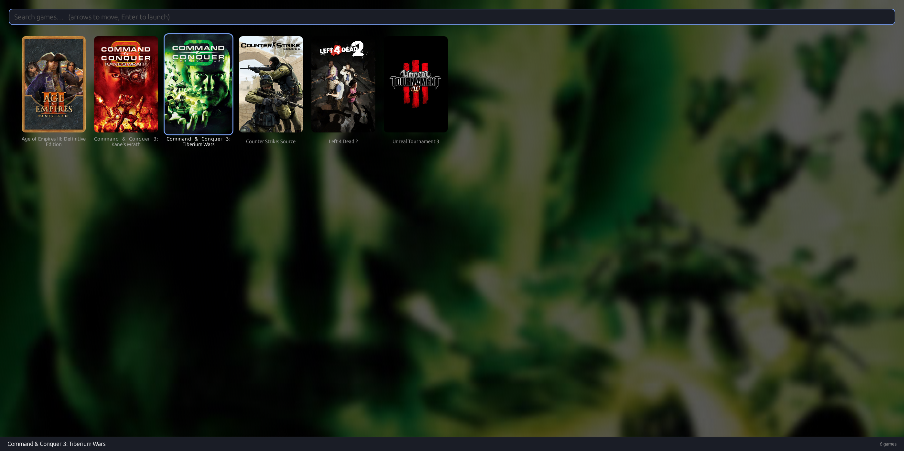

# rsgl

A small, keyboard-driven game launcher for Linux. You list your games in a TOML
file, and rsgl shows them as a grid of cover art. Type to filter, pick one with
the arrow keys, hit Enter, and the launcher starts the game and closes.

If you give it a [SteamGridDB](https://www.steamgriddb.com/) API key, it
downloads missing covers and hero images for you, then draws a blurred version
of the selected game's art behind the grid.




## Features

- Cover-art grid with search-as-you-type filtering
- Full keyboard control, mouse works too
- Automatic cover and hero downloads from SteamGridDB (optional)
- Blurred, crossfading background for the selected game
- Per-game working directory and environment variables
- Games are started detached, so they keep running after the launcher closes
- Games without a cover get a colored placeholder with their initial

## Building

You need a recent stable Rust toolchain.

```sh
cargo build --release
./target/release/rsgl
```

rsgl uses `eframe`/`egui` with OpenGL and supports both Wayland and X11. It
only builds on Unix, since it detaches games with Unix process groups.

## Configuration

rsgl reads the first of these files that exists:

1. `$XDG_CONFIG_HOME/rsgl/rsgl.toml` (usually `~/.config/rsgl/rsgl.toml`)
2. `~/.rsgl.toml`

If neither exists, the first run writes an example config to
`~/.config/rsgl/rsgl.toml` and shows a message telling you to edit it and
restart.

```toml
[ui]
card_width = 170   # card width in pixels, clamped to 80-400
blur = 8           # background blur strength, 0 turns blur off (max 50)

[api]
steamgriddb_key = "your-key-here"

[[game]]
name = "Example Game"
exec = "~/games/example/start.sh"
cover = "~/.cache/rsgl/covers/example.png"   # optional
workdir = "~/games/example"                  # optional
env = { SOME_VAR = "value" }                 # optional
```

Notes on `[[game]]` entries:

- `exec` runs through `sh -c`, so arguments, quoting and pipes all work.
- A leading `~` is expanded in `exec`, `cover`, `workdir` and `env` values.
- Games are sorted by name (case-insensitive), not by their order in the file.
- If `cover` is missing or doesn't exist, rsgl looks in the covers cache (see
  below) for a file named after the game.

### SteamGridDB key

Get an API key from your SteamGridDB account preferences. You can set it in the
config as shown above, or with the `STEAMGRIDDB_API_KEY` environment variable,
which takes priority over the config file. Without a key, rsgl only uses
images that are already on disk.

## Controls

| Key           | Action                                   |
| ------------- | ---------------------------------------- |
| Type          | Filter games by name                     |
| Arrow keys    | Move the selection                       |
| Enter / click | Launch the selected game and close rsgl  |
| Esc           | Clear the search, or quit if it's empty  |

## Cache

Downloaded and generated images live under `~/.cache/rsgl`:

- `covers/` — cover art, named `<slug>.png|jpg|webp`
- `heroes/` — wide hero images used for backgrounds
- `backgrounds/` — blurred backgrounds, regenerated automatically when `blur` changes

The slug is the game name lowercased, with every non-alphanumeric character
replaced by `_` (so "Hollow Knight: Silksong" becomes `hollow_knight__silksong`).
You can drop your own images into `covers/` or `heroes/` with that name and rsgl
will use them instead of downloading. Deleting a file makes rsgl fetch it again
on the next start.

Older versions saved images to `~/.local/share/game-covers` and
`~/.local/share/game-heroes`. Those folders are still checked, so existing
downloads keep working.

